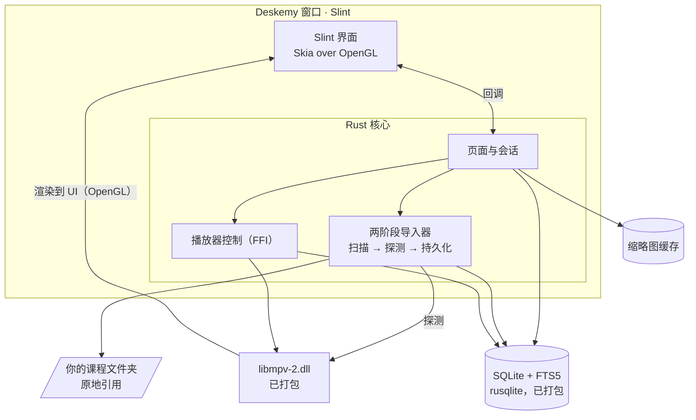

<div align="center">
  

  <h1>Deskemy</h1>

  <p><strong>一款离线播放器，专为你已拥有的视频课程而设计。</strong></p>

  <p>
    
    <a href="https://github.com/NFRohan/Deskemy/releases"></a>
    <a href="https://github.com/NFRohan/Deskemy/stargazers"></a>
    
    
  </p>

  <p>
    <a href="https://github.com/NFRohan/Deskemy/releases/latest"></a>
    <a href="https://github.com/NFRohan/Deskemy/releases/latest"></a>
  </p>

  <p>
    <sub>
      原作者
      <a href="https://github.com/NFRohan"><strong>Nayeem Fardin</strong></a>
      （又名 Spooksy）·
      <a href="https://github.com/NFRohan/Deskemy">github.com/NFRohan/Deskemy</a> ·
      当前版本 <strong>2.1.2</strong>
    </sub>
  </p>
</div>

---

Deskemy 是一款本地、离线的视频课程播放器。只需指向一个课程视频文件夹，它会将其整理为可浏览的课程库，提供播放、进度跟踪、搜索和学习工具。你的视频文件始终留在原地——Deskemy 只引用它们，绝不复制或上传——所有记录都保存在本地的 SQLite 数据库中。

<div align="center">
  
</div>

<details>
<summary><b>更多截图</b> —— 课程详情、播放器、全屏、快捷键、搜索、历史</summary>
<br/>
<table>
  <tr>
    <td></td>
    <td></td>
  </tr>
  <tr>
    <td></td>
    <td></td>
  </tr>
  <tr>
    <td></td>
    <td></td>
  </tr>
</table>
</details>

## 功能

**课程库与导入**
- 将课程文件夹结构化为章节和有序课时，自动清理标题中的数字前缀和扩展名。
- 将字幕和资源文件（PDF、代码、压缩包）附加到对应的课时或章节。代码项目（包含 `package.json`、`node_modules` 等的文件夹）会作为单个资源导入，TypeScript `.ts` 文件不会被误判为视频。
- 显示导入预览——章节、课时、资源、字幕、总时长——扫描过程中实时显示进度。
- 原地引用文件，绝不复制或移动你的视频。再次添加同一课程文件夹会更新课程并保留你的学习进度。

**播放**
- 从上次位置继续播放，自动播放下一集。可为每个课程设置默认播放速度，或使用课程自身的速度；字幕和音轨选择按课程记忆。
- **迷你播放器**：按 `T` 将播放器缩小为一个小型置顶窗口，置于编辑器或终端旁——它会保持视频比例，并在你上次离开的位置打开。
- 资源与课时并列显示，在课程目录和播放器的课程面板中，可逐项勾选；可选地，自动播放会在有练习的课时处停止并提供练习。
- 章节导航、睡眠定时器、字幕/音轨选择。
- 丰富的 YouTube 风格键盘快捷键。

<div align="center">
  
</div>

**整理与回顾**
- 首页的"继续观看"可直接恢复到你上次观看的课时。
- 带时间戳的书签、标签、收藏和观看历史。
- 职业路径——有序的课程组，附带整体完成度。

**搜索**
- 跨课程、章节和课时标题的全文搜索。
- 可选的字幕搜索，可搜索字幕文件中的语音内容，并直接跳转到匹配的时间点。

**进度与维护**
- 观看时长统计：活动热力图（悬停查看当天观看内容）、连续学习天数和每日目标。
- 重命名安全：移动或重命名的文件会保留进度和书签，按内容而非路径匹配。
- 可选的文件夹自动重新扫描，以及用于回收磁盘空间的存储面板。

<div align="center">
  
</div>

## 键盘快捷键

| 按键 | 功能 | | 按键 | 功能 |
|---|---|---|---|---|
| `Space` / `K` | 播放 / 暂停 | | `C` | 切换字幕 |
| `J` / `L` | 后退 / 前进 10 秒 | | `,` / `.` | 减速 / 加速 |
| `←` / `→` | 后退 / 前进 5 秒 | | `N` / `⇧N` | 下一课时 / 上一课时 |
| `↑` / `↓` | 音量增 / 减 | | `P` / `R` | 课程目录 / 资源 |
| `M` | 静音 | | `B` | 为当前时刻添加书签 |
| `F` / `Esc` | 全屏 / 退出 | | `T` | 迷你播放器，置顶 |
| `I` | 播放信息 | | `?` | 显示全部快捷键 |

## 系统要求

- **Windows 10 或 11**，需支持 OpenGL 3.3 的 GPU（过去十年的任何集成显卡均可）。无需 WebView2。
- **Linux（测试版）**：2024 年或更新的发行版（glibc 2.39）：Ubuntu 24.04+、Linux Mint 22+、Debian 13+、Fedora 40+ 或 openSUSE Tumbleweed，支持 X11 或 Wayland。详见下方 [Linux](#linux-测试版)。
- macOS 后续支持。

所有组件均已打包。Deskemy 通过 **libmpv**（mpv 的媒体库，`libmpv-2.dll`）播放，该库已包含在安装包和便携版 zip 中——无需单独安装 mpv。如果你想使用自己的编译版本，Deskemy 也会从 `PATH` 或 `DESKEMY_LIBMPV` 中查找 `libmpv-2.dll`。

## 安装

1. 从发布页面下载最新安装程序（`deskemy_<版本>_x64-setup.exe`）。
2. 运行安装程序。
3. 启动 Deskemy → **添加文件夹** → 选择课程文件夹。

这是单用户安装（无需管理员权限）。如需为所有用户安装到 Program Files（需要管理员权限），请改用 MSI（`deskemy_<版本>_x64_en-US.msi`）。两种方式都会自动更新：有新版本时，Deskemy 会提示（点击**更新**前不会下载任何内容），且**设置 → 关于**中有检查按钮。从 Deskemy 1.x 升级时，更新会覆盖安装并保留你的课程库。从**设置 → 应用**中卸载会移除程序、快捷方式和注册表项。`%APPDATA%\com.spooksy.deskemy` 下的课程库索引和设置会保留，以便重新安装后继续使用——如需彻底清除，请删除该文件夹。

### 便携版（免安装）

无需安装即可运行，请下载**便携版 zip**，解压后运行 `deskemy.exe`。可执行文件旁的 `.portable` 标记文件会将所有数据（课程库、设置、缩略图）保存在旁边的 `data/` 文件夹中，因此不会写入 `%APPDATA%` 或注册表。删除文件夹即可完全移除。（便携版无法自动更新；Deskemy 会引导你前往发布页面。）

### Linux（测试版）

每个下载包都自带 Deskemy 的 libmpv、编解码器和 PDF 查看器，因此无需安装 mpv 或编解码器包（即使是精简的 Fedora 也能播放 H.264 课程）。

- **Fedora、openSUSE：** 下载 `deskemy_<版本>_x86_64.rpm`，在软件中心打开，或运行 `sudo dnf install ./deskemy_<版本>_x86_64.rpm`。
- **Ubuntu、Debian、Mint：** 下载 `deskemy_<版本>_amd64.deb` 打开，或运行 `sudo apt install ./deskemy_<版本>_amd64.deb`。
- **任意发行版：** AppImage（`Deskemy_<版本>_x86_64.AppImage`）。请先将其设为可执行（右键 → 属性 → *允许作为程序执行*，或 `chmod +x`）；在此之前，打开它可能会提示将其写入磁盘。

AppImage 与 Windows 安装程序一样会自动更新。.deb 和 .rpm 会引导你前往发布页面，新包会覆盖旧包安装。你的课程库和设置位于 `~/.local/share/com.spooksy.deskemy`。

在 Wayland 桌面环境下，Deskemy 通过 XWayland 运行，这样迷你播放器可以置顶且支持拖放；`DESKEMY_WAYLAND=1` 可原生运行（但不支持上述两项功能）。这是测试版：请在 [#7](https://github.com/NFRohan/Deskemy/issues/7) 或新 issue 中反馈可用和不可用的功能，并注明你的发行版、桌面环境和 GPU。

## 社区翻译

由社区作为独立项目维护，因此可能滞后于最新版本。翻译相关问题请在对应项目的仓库中提出。

- **简体中文** —— [Deskemy-zh-CN](https://github.com/flipped0419/Deskemy-zh-CN)，作者 [@flipped0419](https://github.com/flipped0419)

## 从源码构建

```bash
# 前置条件：Rust（stable）、MSVC C++ Build Tools，以及 app/vendor/ 中的
# libmpv-2.dll（mpv 的 "libmpv" 构建版本；构建时会复制到 exe 旁）。
# PDFium（用于 PDF 查看器）也放在该目录（没有它，PDF 会在外部打开）：
powershell -File app/scripts/get-pdfium.ps1
cd app
cargo run              # 开发模式运行
cargo test             # 运行测试（播放测试使用无头 mpv）
```

发布版本使用 cargo-packager 打包——详见 [docs/releasing.md](docs/releasing.md)。
Deskemy 1.x 是 Tauri + Svelte 应用；其规划文档位于 [docs/archive/](docs/archive/)，代码在 git 历史中（截至 `v1.2.2`）。

## 技术栈

| 层级 | 说明 |
|---|---|
| **界面** | [Slint](https://slint.dev)（Rust）· Skia 渲染器，已打补丁以支持 ClearType 风格文本 |
| **核心** | Rust（`crates/deskemy-core`）· 通过 `rusqlite`（已打包）使用 SQLite + FTS5 |
| **播放** | libmpv，通过 FFI（`libloading`）运行时加载，直接渲染到 UI 的 OpenGL 上下文中——随应用打包，支持系统/`DESKEMY_LIBMPV` 回退 |
| **存储** | 本地 SQLite 数据库 + 应用数据目录下的内容寻址缩略图缓存 |

导入分两阶段进行——先探测，再持久化——因此媒体探测在数据库连接之外进行，扫描大型课程时不会阻塞 UI。

**整体架构**



## 隐私

无账户、无遥测、不会为你的内容发起任何网络请求。你的课程库、进度、书签和统计数据仅保存在本地数据库中；应用完全离线运行。唯一的网络请求是更新检查：从 GitHub 读取最新版本的清单，除非你选择更新，否则不会下载任何内容。

## 许可证

[MIT](LICENSE) © 2026 Nayeem Fardin。
